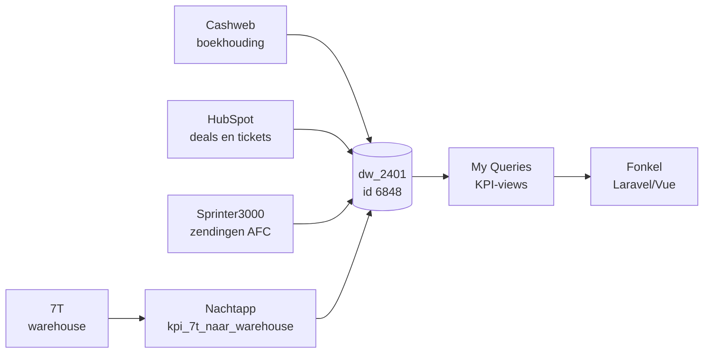
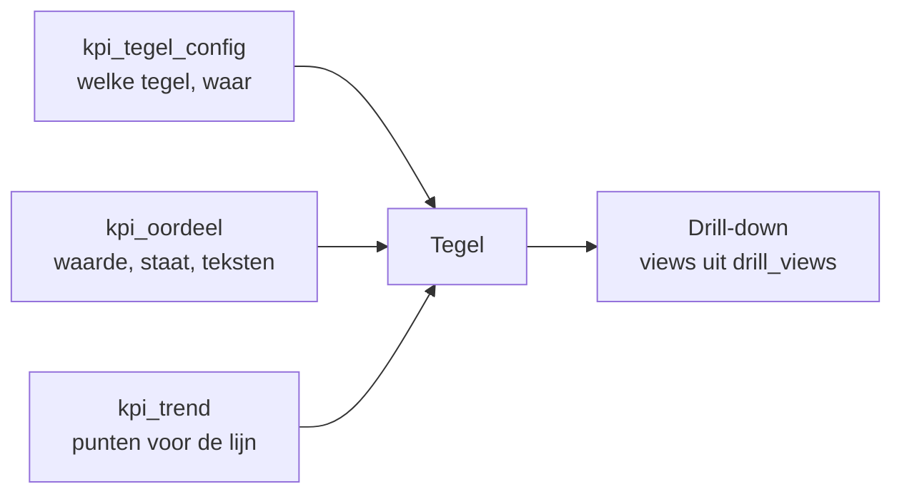

# Overdracht AWC KPI-dashboard aan Fonkel

22 september 2026 · Chloë Zuijdwijk (Stratego)

## Doel en afbakening

Fonkel bouwt het MT-dashboard in Laravel/Vue; alle KPI-logica zit al in Peliqan en wordt als kant-en-klare views aangeleverd. De frontend rekent dus niets zelf uit: hij leest tegels, reeksen en controles en toont ze.

- **Peliqan-laag (Stratego, Chloë):** bronkoppelingen, berekeningen, definities, aannames, datacontroles.
- **Frontend (Fonkel):** schermen per niveau (Strategisch, Operationeel, Tactisch) en per team (AWC, AFC, ACC), drill-downs, doelen invoeren, datakwaliteit tonen.
- **Referentieontwerp:** het klikbare ontwerp in Claude (artifact) toont per tegel wat er staat, welke view erachter zit en wat de drill-down laat zien. Bij twijfel geldt het ontwerp.

Buiten scope voor deze overdracht: de Sprinter3000-koppeling herstellen (rechtenprobleem bij AFC), Hooray en Microsoft Forms koppelen, NPS en automatiseringsdoelen (gepland voor 2027).

## Spelregels

De frontend toont, Peliqan rekent. Elke regel hieronder voorkomt een fout die we al een keer bijna maakten.

1. **Nooit rekenen in de frontend.** Geen sommen, gemiddelden, percentages, rollende totalen of concerntotalen. Elk getal op het scherm staat letterlijk in een tabel. Ontbreekt er een getal, vraag het aan Chloë; zij voegt het toe in Peliqan.
2. **Nooit de Peliqan-views aanpassen.** Fonkel leest alleen. Schrijven gebeurt uitsluitend in de drie tabellen van `kpi_invoer`.
3. **Nooit `pglh` tonen.** Die administratie-code mag in geen enkele lijst, filter of tooltip verschijnen. Scopes zijn alleen `concern`, `alaw`, `pgl1`, `acco` en de twee pijplijnnamen van winrate.
4. **Nooit een getal tonen bij een andere staat dan `meetwaarde`.** Ook niet grijs, ook niet "ter indicatie". De ontwerpbestanden tonen soms grijze referentiegetallen; die zijn alleen voor de vormgeving.
5. **Nooit kpi\_codes, scopes of teksten hardcoden.** Titels, volgorde en bronlabels komen uit `kpi_tegel_config`; definities en aannames uit `kpi_oordeel`.
6. **Klopt iets niet met Peliqan, dan is Peliqan leidend.** Verschilt het scherm van de acceptatietest (hoofdstuk Acceptatietest), dan zit de fout in de frontend tot het tegendeel bewezen is.

Vragen over cijfers en definities: Chloë. Vragen over de operatie (7T, dock-to-stock, schade): Edo. Vragen over de boekhouding: Frits, via Chloë.

## Architectuur

Vijf bronnen komen in één Peliqan-warehouse samen; de frontend leest alleen uit het schema My Queries en uit twee kleine data-schema's.

De 7T-database wordt niet gerepliceerd; de nachtapp leest 7T live en schrijft maandcijfers weg in het schema kpi\_data.

| Onderdeel | Waar | Id |
| --- | --- | --- |
| Warehouse | dw\_2401 | database 6848 |
| KPI-views | schema My Queries | schema 45821 |
| Door apps geschreven tabellen | schema kpi\_data |  |
| Handmatige invoer en doelen | schema kpi\_invoer |  |
| 7T (live, niet gerepliceerd) | DB7T, schema dbo | database 7866 |
| Nachtapp 7T | app kpi\_7t\_naar\_warehouse | 13737 |
| Setup- en testapp | app kpi\_invoer\_setup | 13738 |
| Connectie Cashweb |  | 12794 |
| Connectie HubSpot V2 |  | 11865 |
| Connectie Sprinter3000 |  | 12788 |
| Connectie 7T |  | 13491 |

## Toegang en welke tabellen je leest

Fonkel leest uit de Postgres-database `dw_2401` van Peliqan, nooit uit de Peliqan-views zelf. De views in schema `My Queries` bestaan alleen binnen Peliqan; wat een externe app ziet, zijn de gerepliceerde kopieën met de achtervoegsel `_my_queries`.

**Verbinding.** Host, poort, gebruiker en wachtwoord staan in Peliqan onder de instellingen van het datawarehouse. Chloë maakt een eigen databasegebruiker voor Fonkel aan (alleen lezen op `My Queries` en `kpi_data`, lezen en schrijven op `kpi_invoer`) en deelt de gegevens via een wachtwoordkluis, nooit per mail. Verbind altijd met SSL.

**Welke tabel voor welk doel.**

| Doel | Tabel in dw\_2401 | Ververst |
| --- | --- | --- |
| Tegelwaarde, staat, teksten | `"My Queries".kpi_oordeel_my_queries` | Elk uur |
| Schermindeling | `"My Queries".kpi_tegel_config_my_queries` | Elk uur (wijzigt zelden) |
| Trendlijn op elke tegel | `"My Queries".kpi_trend_my_queries` | Elk uur |
| KPI-stamgegevens | `"My Queries".kpi_registry_my_queries` | Elk uur |
| Datacontroles en header | `"My Queries".kpi_controles_my_queries` | Elk uur |
| Drill-down tabellen | `"My Queries".<view>_my_queries` (zie hoofdstuk Datadictionary) | Elk uur |
| Doelen, handmatige invoer, validatie | `kpi_invoer.doelen`, `kpi_invoer.handmatig`, `kpi_invoer.validatie` | Direct (echte tabellen) |

De schema-naam bevat een spatie: altijd tussen dubbele aanhalingstekens. De gerepliceerde tabellen worden bij elke run volledig vervangen; lees ze dus nooit halverwege een lange transactie en cache niets langer dan een uur.

Na de eerste replicatie (binnen een uur na 22 september) moeten er 28 tabellen met `_my_queries` in `My Queries` staan. Ontbreekt er een, meld het aan Chloë in plaats van terug te vallen op een andere tabel.

## Het contract: kpi\_oordeel en kpi\_registry

De frontend leest voor elke tegel één rij uit kpi\_oordeel (tabel 1416385): per KPI en per scope de waarde, het oordeel en alle tekst eromheen. kpi\_registry (tabel 1416381) is de bron voor naam, definitie en aanname en zit al in kpi\_oordeel verwerkt.

| Kolom | Wat de frontend ermee doet |
| --- | --- |
| kpi\_code, naam, niveau, pijler | Welke tegel en op welk scherm (niveau: strategisch, tactisch, operationeel, team\_awc, team\_acc) |
| scope\_code, scope\_label | Concern of entiteit: concern, alaw (AWC), pgl1 (AFC), acco (ACC). Uitzondering: winrate gebruikt de pijplijnnaam als scope (Verkooppijplijn, AFC - Verkooplijn). KPI's zonder data hebben één rij met lege scope. |
| waarde, waarde\_vorige, delta, eenheid, richting | Het grote getal, de vergelijking en de kleur van de pijl (hoger\_beter, lager\_beter, neutraal) |
| weergave | Bepaalt de tegelstaat: meetwaarde, te\_weinig\_data, wacht\_op\_invoer, in\_ontwikkeling, tbd, gepland\_2027. Zie Tegelstaten. |
| leeg\_reden | Tekst als er geen getal staat |
| doel, status, afstand\_tot\_doel | Doel-chip: op\_doel, bijna, onder\_doel; leeg als er geen doel is |
| venster, stand\_per, bron\_bijgewerkt | Onderregel van de tegel en de stand-datum |
| toelichting | Korte uitsplitsing onder het getal |
| definitie, kanttekening, aanname, wijziging | Drill-down: definitieblok, aanname-blok (oranje) en versiegeschiedenis |
| historie\_view | Bron van de reeks in de drill-down. Voor de trendlijn op de tegel altijd kpi\_trend gebruiken, niet deze view. |
| tonen\_op\_dashboard | false = niet tonen (NPS en automatiseringsdoelen tot 2027) |

Regel voor de frontend: toon alleen een getal als weergave = meetwaarde. Bij alle andere waarden toont de tegel leeg\_reden, zodat er nooit een half getal op het scherm staat.

Een nieuwe KPI toevoegen gaat altijd via de registry plus een tegel-view; kpi\_oordeel pakt hem dan vanzelf op.

## Schermindeling en trendlijnen

Elk scherm wordt opgebouwd uit `kpi_tegel_config`: één rij per tegel, sectie of header, in de volgorde van `positie`. Fonkel verzint geen tegels en laat er geen weg; de volledige lijst staat in het hoofdstuk Tegels per scherm.

**Een tegel vullen, stap voor stap.**

1. Lees de configrij (`scherm`, `positie`).
2. Is `waarde_bron` gelijk aan `vast`: toon titel, `vaste_staat` en `vaste_tekst`. Geen getal. Heeft de rij een `trend_kpi_code`, toon dan wel de trendlijn (de drie Sprinter-tegels).
3. Is `waarde_bron` gelijk aan `kpi_oordeel`: zoek de rij in `kpi_oordeel_my_queries` met dezelfde `kpi_code` en `COALESCE(scope_code, '')` gelijk aan de `scope_code` uit de config. Een lege scope in de config betekent: de KPI heeft nog geen data en `kpi_oordeel` heeft dan precies één rij met een lege scope (OTIF, eNPS, A/B Players).
4. Vind je geen rij, toon dan de staat `data_ontbreekt` (zie Tegelstaten) en log het. Val nooit terug op een andere scope.
5. Trendlijn: alle rijen uit `kpi_trend_my_queries` met `kpi_code` = `trend_kpi_code` en `scope_code` = `trend_scope_code`, gesorteerd op `periode`. Geen `trend_kpi_code` = geen lijn.
6. Drill-down: de views uit `drill_views` (kommagescheiden, in die volgorde), elk als `<view>_my_queries`.

**kpi\_trend in het kort.** Eén rij per punt: `kpi_code`, `scope_code`, `serie`, `periode`, `waarde`, `status`, `volgnummer`. Alles is al uitgerekend: jaar-tot-nu voor bruto marge, rollend twaalf maanden voor EBITDA en omzet, percentages voor winrate. Bij `acc_dossiers` zijn er vier series (Import, Export, Consult, Overig); teken die als aparte lijnen. Bij alle andere KPI's is `serie` leeg. Een punt met `status` `voorlopig` of `onvolledig` teken je gestippeld of open; `definitief` als gewone lijn.

## Tegelstaten

Een tegel heeft precies één staat. Bij tegels uit `kpi_oordeel` bepaalt `weergave` de staat, bij vaste tegels `vaste_staat`. Alleen `meetwaarde` toont een getal.

| Staat | Komt uit | Getal | Pijl en vergelijking | Trendlijn | Tekst op de tegel | Label |
| --- | --- | --- | --- | --- | --- | --- |
| `meetwaarde` | weergave | Ja | Ja, als `waarde_vorige` gevuld is | Ja | `venster` onder het getal, `toelichting` daaronder | geen |
| `te_weinig_data` | weergave | Nee | Nee | Ja, als die er is | `leeg_reden` | Te weinig data |
| `wacht_op_invoer` | weergave | Nee | Nee | Nee | `leeg_reden` + knop naar invoer (Tactisch) | Wacht op invoer |
| `tbd` | weergave | Nee | Nee | Nee | `leeg_reden` | Definitie volgt |
| `in_ontwikkeling` | weergave | Nee | Nee | Nee | `leeg_reden` | In ontwikkeling |
| `gepland_2027` | weergave | Nee | Nee | Nee | Niet als tegel; alleen in de sectie Gepland voor 2027 | – |
| `in_opbouw` | vaste\_staat | Nee | Nee | Nee | `vaste_tekst` | In opbouw |
| `in_validatie` | vaste\_staat | Nee | Nee | Nee | `vaste_tekst` | In validatie |
| `data_onvolledig` | vaste\_staat | Nee | Nee | Ja, onvolledige punten open | `vaste_tekst` | Data onvolledig (rood) |
| `niet_meetbaar` | vaste\_staat | Nee | Nee | Nee | `vaste_tekst` | Niet meetbaar |
| `data_ontbreekt` | frontend | Nee | Nee | Nee | "Geen gegevens gevonden. Meld dit aan Chloë." | Data ontbreekt (rood) |

**Doel-chip.** Alleen bij `meetwaarde` en alleen als `doel` gevuld is. `status` is dan `op_doel` (groen), `bijna` (oranje) of `onder_doel` (rood). Toon `doel_tekst` in de tooltip. Leeg `doel` = geen chip, ook geen grijze.

**Randgevallen.**

- `weergave` is `meetwaarde` maar `waarde` is leeg: behandel als `data_ontbreekt`. Mag niet voorkomen.
- `waarde_vorige` leeg (bijvoorbeeld ACC-dossiers, time to onboarding): geen pijl en geen vergelijkingsregel, wel het getal.
- Negatieve waarden (een verliesmaand, een negatieve marge per zending) toon je met een minteken, nooit tussen haakjes en nooit als 0.
- `delta` is 0: grijze horizontale pijl, tekst "gelijk".
- `tonen_op_dashboard` is false: rij overslaan, ook als de config hem noemt.
- Een scope-rij verschijnt of verdwijnt in `kpi_oordeel` (bijvoorbeeld zodra eNPS wordt ingevoerd krijgt die een echte scope): de config-regel met lege scope matcht dan niet meer. Val dan terug op de enige rij voor die `kpi_code` als er precies één is; anders `data_ontbreekt`.

## Opmaakregels

Alle getallen in Nederlandse notatie (`nl-NL`): komma als decimaalteken, punt als duizendtal. De kolom `eenheid` in `kpi_oordeel` bepaalt de opmaak; rond pas af bij het tonen, nooit eerder.

| eenheid | Getal op de tegel | Vergelijking (delta) | Voorbeeld |
| --- | --- | --- | --- |
| `ratio` | 2 decimalen, geen eenheid | ±2 decimalen | 2,40 · +0,04 |
| `procent` | 1 decimaal + % | In procentpunten: ±1 decimaal + " pp", nooit % | 88,4% · +11,0 pp |
| `euro` | Vanaf 1 miljoen: 2 decimalen + " mln"; vanaf 10.000: hele duizenden + "k"; daaronder het hele bedrag | Zelfde schaal als de waarde, plus de procentuele verandering | € 1,19 mln · −€ 0,56 mln (−32%) |
| `aantal` | Heel getal met duizendtalpunt | ±heel getal, plus procentuele verandering | 13.588 · −2.796 (−17%) |
| `dagen` | 1 decimaal + " dagen" | ±1 decimaal + " dagen" | 2,8 dagen |
| `score` | Heel getal, mag negatief | ±heel getal | −12 |

**De enige berekening die de frontend mag doen** is de procentuele verandering bij `euro` en `aantal`: `delta / ABS(waarde_vorige) × 100`, afgerond op een heel procent. Is `waarde_vorige` leeg of 0, laat het percentage weg.

**Pijl en kleur.** De pijl volgt altijd de richting van het getal (omhoog als `delta` > 0). De kleur volgt `richting` uit `kpi_oordeel`: bij `hoger_beter` is omhoog groen en omlaag rood, bij `lager_beter` omgekeerd, bij `neutraal` altijd grijs. Lees `richting` altijd uit de data; ga nooit zelf uit van wat "goed" is.

**Datums.** Valt `stand_per` op de 1e van een maand, dan geldt het getal voor die hele maand: toon "juli 2026". Valt het op een andere dag (churn, winrate, ACC-dossiers, doorlooptijd, onboarding: stand van vandaag), toon dan "22 september 2026". `bron_bijgewerkt` en `gecontroleerd_op` zijn in UTC opgeslagen: toon ze in Europe/Amsterdam als "22-09-2026 14:03".

**Voorlopig en trendbreuk.** Een voorlopige of onvolledige maand in de trendlijn is een open punt of gestippeld stuk, met de status in de tooltip. Twee bekende trendbreuken: winrate vanaf september 2026 (nieuwe fase-indeling) en de Sprinter-reeksen vanaf augustus 2026 (koppeling onvolledig). Die staan al als `voorlopig` of `onvolledig` in `kpi_trend`; de frontend hoeft niets extra's te weten.

## KPI-overzicht

17 KPI's staan in de registry: 12 live met een meetwaarde, 2 met handmatige invoer die nog leeg is, 1 met een open definitie en 2 gepland voor 2027.

| KPI | Niveau | Bron | Tegel-view | Maandreeks | Status |
| --- | --- | --- | --- | --- | --- |
| Bruto marge per loonkosten | strategisch | Cashweb | kpi\_bm\_tegel | kpi\_bm\_maand | live |
| % Triple LOB | strategisch | Cashweb | kpi\_triple\_lob\_tegel | kpi\_triple\_lob\_maand | live |
| Winrate | strategisch | HubSpot | kpi\_winrate\_tegel | kpi\_winrate\_maand | live |
| Churn | strategisch | HubSpot | kpi\_hs\_tegel | kpi\_churn\_kwartaal | live, op aanname |
| OTIF | strategisch | 7T | geen | geen | definitie bij Edo |
| Omzetbrug | strategisch | Cashweb | kpi\_omzetbrug\_tegel | kpi\_omzet\_lob | live |
| EBITDA | strategisch | Cashweb | kpi\_ebitda\_tegel (1418996) | kpi\_ebitda\_maand (1418995) | live |
| A/B Players | strategisch | handmatig | via kpi\_handmatig | geen | wacht op invoer Daphne |
| eNPS | tactisch | handmatig | via kpi\_handmatig | geen | wacht op invoer Daphne |
| Dock-to-stock binnen 24 uur | team\_awc | 7T (nachtapp) | kpi\_d2s\_tegel (1416770) | kpi\_d2s\_maand (1416856) | live |
| Damage rate inbound | team\_awc | 7T (nachtapp) | kpi\_awc\_ops\_tegel (1419016) | kpi\_awc\_ops\_maand (1419015) | live |
| Throughput | team\_awc | 7T (nachtapp) | kpi\_awc\_ops\_tegel (1419016) | kpi\_awc\_ops\_maand (1419015) | live |
| Dossiers per soort | team\_acc | HubSpot | kpi\_hs\_tegel | kpi\_acc\_dossiers\_maand | live |
| Doorlooptijd dossier | team\_acc | HubSpot | kpi\_hs\_tegel | kpi\_acc\_doorlooptijd\_maand | live |
| Time to onboarding | operationeel | HubSpot | kpi\_hs\_tegel | kpi\_onboarding\_kwartaal | live |
| NPS, intern en extern | tactisch | geen | geen | geen | gepland 2027 |
| % behaalde automatiseringsdoelen | tactisch | geen | geen | geen | gepland 2027 |

De AFC-tegels op Sprinter3000 (zendingen, modal split, marge per zending) staan niet in de registry; ze hebben de status Data onvolledig zolang de Sprinter-koppeling sinds augustus niet alles ophaalt. Inventory accuracy staat in validatie; storage lead time is niet betrouwbaar te meten (zie beperkingen).

## Drill-down views

Naast de tegel en de maandreeks hebben een aantal KPI's extra views voor de tabellen in de drill-down.

| View | Tabel-id | Voor welke drill-down | Inhoud |
| --- | --- | --- | --- |
| kpi\_kosten\_maand | 1418999 | EBITDA (concern en per entiteit) | Omzet en kostengroepen per maand per entiteit: inkoop, eigen personeel, uitzendkrachten, huisvesting, machines, overig |
| kpi\_omzetbrug | 1416464 | Omzetbrug en Omzet en klanten per entiteit | Brug per scope: start, nieuw, gegroeid, gekrompen, verloren, eind, met aantal klanten |
| kpi\_omzetbrug\_klant | 1416722 | Idem | Alle klantregels met rang\_groei en rang\_krimp voor de top-bewegers |
| kpi\_awc\_schade\_klant | 1419084 | Damage rate | Schade per klant (eigenaar van de goederen) in het lopende jaar |
| kpi\_intercompany |  | Omzetbrug | Zes eigen relaties die niet als klantomzet tellen |
| kpi\_triple\_lob\_te\_controleren |  | Triple LOB en datacontroles | Werklijst van nog te beoordelen triple-matches |
| kpi\_winrate\_fases |  | Winrate | Welke dealfases als gewonnen tellen |

De cijfers in de drill-down-tabellen van het ontwerp komen uit deze views; de frontend haalt ze live op in plaats van ze over te nemen.

## Datacontroles

kpi\_controles (tabel 1418985) draait 14 automatische checks; stand 22 september: 1 fout, 2 let op, 11 ok. De frontend toont de telling als statuspil in de header en de volledige lijst op het tabblad Tactisch.

| Soort | Controles | Norm |
| --- | --- | --- |
| Versheid | Cashweb, HubSpot, Sprinter3000, 7T dock-to-stock, 7T schade en throughput | Laatste sync binnen 36 uur, let op tot 72 uur |
| Volume | Sprinter3000, HubSpot Customs Pipeline, 7T inbounds, 7T manco-registratie | Vorige maand minimaal 50% van het gemiddelde van de drie maanden daarvoor |
| Aansluiting | Omzetbrug tegenover grootboek | Verschil tussen 0 en 3% (intercompany) |
| Aansluiting | EBITDA tegenover SAR-waardering boekjaar 2025 | Binnen 2% |
| Aansluiting | EBITDA tegenover kostengroepen | Onder 1.000 euro |
| Dekking | Dekking dock-to-stock | 55 tot 70% van de inbounds met een verplaatsing |
| Werklijst | Triple LOB-matches te controleren | 0 |

Kolommen: volgorde, soort, controle, bron, waarde, norm, status (ok, let\_op, fout), toelichting, gecontroleerd\_op. De enige fout is nu Sprinter3000 (50 zendingen in augustus tegen gemiddeld 622).

## Invoer en doelen

Handmatige cijfers en doelen worden in het schema kpi\_invoer opgeslagen en via views gelezen; de frontend schrijft alleen naar deze tabellen.

| Tabel | Wat erin staat | Wie vult | Gelezen via |
| --- | --- | --- | --- |
| kpi\_invoer.handmatig | Handmatige KPI-waarden per periode en scope (A/B Players, eNPS) plus de SAR-jaarcijfers EBITDA 2019 tot en met 2025 | Daphne, Frits | kpi\_handmatig |
| kpi\_invoer.doelen | Doel, marge voor bijna, geldig vanaf, per KPI en scope | MT, via de doel-editor in de tegel | kpi\_doelen |
| kpi\_invoer.validatie | Akkoord van de eigenaar op de aanname per KPI | Eigenaren, in de validatieronde van oktober | nog geen view |

- **Id-conventie handmatig:** `kpi_code|scope|periode_einde`, bijvoorbeeld `ebitda|concern|2025-12-31`. Invoer met hetzelfde id overschrijft.
- **EBITDA-rijen:** kpi\_oordeel sluit handmatige EBITDA uit; de SAR-cijfers dienen alleen als jaarcontrole.
- **Doelen:** het laatste doel met geldig\_vanaf op of voor vandaag geldt. Een doel wijzigen = een nieuwe rij, zodat de historie blijft.

## Schrijven naar kpi\_invoer

Fonkel schrijft alleen in deze drie tabellen, altijd met een upsert op `id`. De kolom `id` is de primaire sleutel en tekst; de vorm staat per tabel hieronder. Een nieuwe invoer verschijnt na de volgende replicatie (uiterlijk een uur) op de tegel.

**kpi\_invoer.doelen** (nu 0 rijen)

| Kolom | Type | Verplicht | Regel |
| --- | --- | --- | --- |
| `id` | text | Ja | `kpi_code\|scope_code\|geldig_vanaf`, bijvoorbeeld `ebitda\|concern\|2027-01-01` |
| `kpi_code` | text | Ja | Moet bestaan in `kpi_registry` |
| `scope_code` | text | Ja | Een scope die voor deze KPI in `kpi_oordeel` voorkomt |
| `geldig_vanaf` | date | Ja | Altijd de 1e van een maand |
| `doel` | numeric | Ja | In dezelfde eenheid als de KPI: procent als 85.0, niet 0.85; euro als heel bedrag |
| `marge_bijna` | numeric | Nee | Afstand tot het doel die nog als "bijna" telt, in dezelfde eenheid |
| `vastgesteld_door` | text | Ja | Naam van de persoon |
| `ingevoerd_op` | timestamptz | Ja | `now()` van de database, niet van de browser |
| `opmerking` | text | Nee | Vrij |

**kpi\_invoer.handmatig** (nu 25 rijen: EBITDA-jaarcijfers uit de SAR)

| Kolom | Type | Verplicht | Regel |
| --- | --- | --- | --- |
| `id` | text | Ja | `kpi_code\|scope_code\|periode_einde`, bijvoorbeeld `enps\|concern\|2026-12-31` |
| `kpi_code` | text | Ja | Alleen KPI's met bouwstatus `handmatig` in `kpi_registry` (eNPS, A/B Players) |
| `scope_code` | text | Ja | Voor eNPS en A/B Players altijd `concern` |
| `periode_einde` | date | Ja | Laatste dag van de meetperiode |
| `waarde` | numeric | Ja | eNPS: heel getal van −100 tot 100. A/B Players: procent van 0 tot 100 |
| `n` | integer | Ja | Aantal respondenten of beoordeelde medewerkers, minimaal 1 |
| `ingevoerd_door` | text | Ja | Naam van de ingelogde gebruiker |
| `ingevoerd_op` | timestamptz | Ja | `now()` van de database |
| `opmerking` | text | Nee | Vrij |

De 25 EBITDA-rijen (id begint met `ebitda|`) zijn historische jaarcijfers voor de drill-down. Die mag de invoerpagina niet tonen, wijzigen of verwijderen.

**kpi\_invoer.validatie** (nu 0 rijen; voor de validatieronde in oktober)

| Kolom | Type | Verplicht | Regel |
| --- | --- | --- | --- |
| `id` | text | Ja | `ronde\|kpi_code\|scope_code\|door`, bijvoorbeeld `2026-10\|ebitda\|concern\|Frits` |
| `ronde` | text | Ja | Jaar en maand van de ronde, `2026-10` |
| `kpi_code`, `scope_code` | text | Ja | Zoals in `kpi_oordeel` |
| `waarde_getoond` | text | Ja | Het getal zoals het op het scherm stond, geformatteerd |
| `oordeel` | text | Ja | Precies een van: `akkoord`, `niet_akkoord`, `vraag` |
| `opmerking` | text | Bij `niet_akkoord` en `vraag` | Vrij |
| `door` | text | Ja | Naam |
| `op` | timestamptz | Ja | `now()` van de database |

**Bij een fout.** Valideer in de frontend voordat je schrijft; schrijf nooit een halve rij. Weigert de database (type, sleutel), toon de melding aan de gebruiker en schrijf niets. Een verkeerde invoer corrigeer je met een nieuwe upsert op dezelfde `id`; verwijderen doet alleen Chloë.

## Operationeel

De drie 7T-KPI's hangen aan één nachtapp; al het andere ververst met de bronsynchronisatie van Peliqan.

**Nachtapp kpi\_7t\_naar\_warehouse (13737)** leest 7T live en schrijft drie tabellen in kpi\_data:

| Tabel | Inhoud | Voedt |
| --- | --- | --- |
| dock\_to\_stock\_maand | Per maand: inbounds, dekking, binnen 24 uur, mediaan, 90%-grens, tijdsvakken | Dock-to-stock |
| awc\_operatie\_maand | Per maand: inbounds, uitleveringen, manco's per reden | Damage rate, Throughput |
| awc\_schade\_klant\_maand | Per maand en klant: inbounds en beschadigd aangeleverd | Schade per klant |

De app herschrijft steeds alles vanaf 1 januari 2026, zodat late correcties in 7T meekomen. Staat het schema uit, dan verouderen deze drie tegels; de versheidscontrole slaat dan na 36 uur aan.

**Conventies die de frontend moet kennen**

- Getallen in Nederlandse notatie: komma als decimaalteken, punt voor duizendtallen (19,04 mln; 13.588 orders).
- Een lopende maand heet voorlopig en krijgt een gestippeld eindpunt in de trendlijn.
- Scope-codes zijn de Cashweb-administraties: alaw = AWC, pgl1 = AFC, acco = ACC. De administratie pglh mag nooit op het scherm verschijnen.
- Cashweb slaat omzet negatief op; de views draaien het teken al om. De frontend rekent niet na.
- EBITDA telt boekingen in hun boekjaar; correcties met een datum buiten het boekjaar vallen in januari of december. Daardoor sluit het jaar op de jaarrekening, maar schommelen januari en december sterker.

## Timing en versheid

Een getal is nieuw zodra `bron_bijgewerkt` of `stand_per` in `kpi_oordeel` verandert; de frontend hoeft zelf niets te plannen. De keten heeft wel vertraging, en die moet Fonkel kennen om geen spoken te jagen.

| Stap | Wanneer | Vertraging tot het scherm |
| --- | --- | --- |
| Cashweb, HubSpot, Sprinter3000 naar Peliqan | Peliqan-pipelines, meerdere keren per dag | Tot enkele uren |
| 7T naar `kpi_data` (nachtapp 13737) | Dagelijks 02:00 UTC (04:00 Nederlandse tijd) | Tot 24 uur |
| Peliqan-views naar `_my_queries`-tabellen | Elk uur | Tot 1 uur |
| Invoer in `kpi_invoer` naar de tegel | Via de uurlijkse replicatie van `kpi_oordeel` | Tot 1 uur |

**Maandafsluiting.** Financiële KPI's gebruiken alleen afgesloten maanden. AWC en ACC sluiten na één maand, AFC na twee, en een maand telt pas als de lonen geboekt zijn. Het concern toont de laatste maand die voor alle drie de entiteiten is afgesloten. Het getal springt dus eens per maand, niet elke dag.

**Cache.** Cache hooguit een uur en ververs op het hele uur plus vijf minuten. Toon rechtsboven op elk scherm de oudste `bron_bijgewerkt` van de getoonde tegels, zodat een gebruiker ziet hoe vers het scherm is.

**Als de nachtapp niet draait**, gaan de controles Versheid 7T dock-to-stock en Versheid 7T schade en throughput na 36 uur op `let_op`. De frontend hoeft daar niets mee te doen behalve de header tonen.

## Open besluiten en bekende beperkingen

De views zijn af, maar een aantal aannames wacht nog op bevestiging. Die staan per KPI in de kolom aanname en zijn in de drill-down zichtbaar; de frontend hoeft er niets voor te doen.

| Onderwerp | Stand | Wie beslist |
| --- | --- | --- |
| Intercompany uit de omzetbrug | Aanname: eruit. Concern 19,04 mln in plaats van 19,40 mln | Frits |
| EBITDA uit Cashweb en de daling in 2026 | Sluit op de SAR-cijfers (−0,1% over 2025); daling in 2026 nog te bevestigen | Frits |
| Loonbasis bruto marge per loonkosten | Lijst van Frits plus uitzendkrachten (4517) | Frits |
| Churn live of in validatie | Live op aanname | MT |
| OTIF-definitie | Voorstel: eerst bevestigde leverdatum, in full per orderregel | Edo |
| Inventory accuracy | Rekenregel: exacte match of tolerantie | Edo |
| Dekking dock-to-stock augustus | 53%, normaal 60 tot 65% | Edo |
| Doelen per KPI | Nog geen doelen ingevoerd | MT |

**Bekende beperkingen**

- **Sprinter3000:** sinds begin augustus haalt de koppeling bijna geen zendingen meer op (rechtenprobleem). De AFC-tegels op Sprinter tonen Data onvolledig; de financiële AFC-tegels uit Cashweb zijn wel betrouwbaar.
- **Storage lead time:** niet te meten. 59% van de uitleveringen komt van een standaardpartij zonder ontvangstdatum en geen uitlevering is gekoppeld aan een ontvangstregel.
- **Damage rate:** de manco-registratie loopt pas sinds januari 2026 goed; de eerste maanden zijn waarschijnlijk te laag. 83% van de schade zit bij één klant (Stelz).
- **Bezettingsgraad:** het juiste cijfer staat in space.amsterdamwarehouse.com; daar is nog geen koppeling of export voor.

## Checklist voor livegang

Deze punten moeten af voordat Fonkel op de views bouwt; de eerste drie liggen bij Stratego.

- [x] Nachtelijk schema aan op app kpi\_7t\_naar\_warehouse (13737)
- [x] Replicatie aan op alle 28 tabellen die Fonkel leest (22 september, elk uur)
- [ ] Eigen databasegebruiker voor Fonkel: lezen op My Queries en kpi\_data, lezen en schrijven op kpi\_invoer; gegevens via een wachtwoordkluis
- [ ] Validatieronde oktober: eigenaren bevestigen of corrigeren de aannames
- [ ] Frits: ter informatie over de EBITDA-daling 2026 en de dubbele AFC-afsluiting 2024 (geen antwoord nodig)
- [ ] Edo: OTIF, inventory accuracy, dekking dock-to-stock
- [ ] AFC: Sprinter-rechten herstellen
- [ ] MT: doelen per KPI invoeren
- [ ] Na het eerste uur: controleren dat alle 28 tabellen met \_my\_queries in My Queries staan
- [ ] Fonkel doorloopt het hoofdstuk Acceptatietest en levert per scherm een screenshot naast de verwachte waarden
- [ ] Schrijven naar kpi\_invoer getest in een testschema

---

# Datadictionary

Alle tabellen die de frontend leest, met kolommen en types zoals ze op 22 september 2026 in Peliqan staan. Lees altijd de versie met `_my_queries` erachter, in schema `"My Queries"`. Rijaantallen zijn een momentopname.

## kpi_oordeel

Eén rij per KPI en scope. Sleutel: kpi_code + scope_code (scope kan leeg zijn). Nu 27 rijen.

| Kolom | Type | Betekenis |
| --- | --- | --- |
| `volgorde` | int4 | Sortering binnen de registry |
| `kpi_code` | text | Sleutel van de KPI |
| `naam` | text | Weergavenaam |
| `niveau` | text | strategisch, tactisch, operationeel, team_awc, team_acc (gebruik voor de schermindeling kpi_tegel_config, niet deze kolom) |
| `pijler` | text | Groep op het scherm |
| `eigenaar` | text | Wie over de KPI gaat |
| `validator` | text | Wie de cijfers bevestigt |
| `bron` | text | Bronsysteem |
| `eenheid` | text | ratio, procent, euro, aantal, dagen, score; bepaalt de opmaak |
| `richting` | text | hoger_beter, lager_beter, neutraal; bepaalt de pijlkleur |
| `bouwstatus` | text | live, handmatig, tbd, gepland_2027 |
| `scope_code` | text | concern, alaw, pgl1, acco, of een winrate-pijplijn; leeg als er geen data is |
| `scope_label` | text | Leesbare scope |
| `waarde` | numeric | Het getal op de tegel |
| `waarde_vorige` | numeric | Vergelijkingswaarde; leeg = geen vergelijking |
| `delta` | numeric | waarde min waarde_vorige |
| `n` | int8 | Aantal waarnemingen achter het getal |
| `min_n` | int4 | Minimum n; daaronder te_weinig_data |
| `doel` | numeric | Doel uit kpi_invoer.doelen; leeg = geen doel |
| `afstand_tot_doel` | numeric | waarde min doel |
| `status` | text | op_doel, bijna, onder_doel; leeg zonder doel |
| `weergave` | text | Tegelstaat, zie Tegelstaten |
| `tonen_op_dashboard` | bool | false = overslaan |
| `leeg_reden` | text | Tekst als er geen getal is |
| `doel_tekst` | text | Tekst voor de doel-tooltip |
| `venster` | text | Onderregel van de tegel |
| `updatefrequentie` | text | Voor de drill-down |
| `historie_view` | text | View met de reeks voor de drill-down |
| `stand_per` | date | Periode van het getal |
| `bron_bijgewerkt` | timestamptz | Laatste verversing van de bron, UTC |
| `definitie` | text | Definitieblok in de drill-down |
| `definitie_versie` | int4 | Versienummer |
| `definitie_geldig_vanaf` | date | Sinds wanneer |
| `wijziging` | text | Versiegeschiedenis |
| `toelichting` | text | Korte uitsplitsing onder het getal |
| `kanttekening` | text | Waarschuwing in de drill-down |
| `aanname` | text | Oranje aanname-blok |

## kpi_tegel_config

Eén rij per tegel, sectie of header. Sleutel: scherm + positie. Nu 45 rijen.

| Kolom | Type | Betekenis |
| --- | --- | --- |
| `scherm` | text | header, strategisch, operationeel, tactisch, awc, afc, acc |
| `positie` | int4 | Volgorde op het scherm, vanaf 1 |
| `pijler` | text | Groepskop; 'sectie' = geen tegel maar een tabelsectie |
| `titel` | text | Titel boven de tegel |
| `kpi_code` | text | Koppeling met kpi_oordeel; leeg bij vaste tegels |
| `scope_code` | text | Koppeling met kpi_oordeel; '' = KPI zonder data |
| `waarde_bron` | text | kpi_oordeel, vast, kpi_controles of kpi_registry |
| `vaste_staat` | text | Staat bij waarde_bron = vast |
| `vaste_tekst` | text | Tekst bij vaste tegels en secties |
| `trend_kpi_code` | text | Koppeling met kpi_trend; leeg = geen lijn |
| `trend_scope_code` | text | Koppeling met kpi_trend |
| `drill_views` | text | Kommagescheiden views voor de drill-down |
| `bron_label` | text | Bronregel onderaan de tegel |
| `element` | text | header, banner, tegel of sectie; bepaalt welk component de frontend tekent |

## kpi_trend

Eén rij per punt in een trendlijn. Sleutel: kpi_code + scope_code + serie + periode. Nu 443 rijen. Vanaf december 2024. Bruto marge = jaar-tot-nu, EBITDA en omzet = rollend twaalf maanden, winrate = procent gewonnen van gewonnen plus verloren.

| Kolom | Type | Betekenis |
| --- | --- | --- |
| `kpi_code` | text | Zelfde codes als kpi_oordeel, plus afc_zendingen, afc_modal_split, afc_marge_per_zending |
| `scope_code` | text | Zelfde scopes als kpi_oordeel |
| `serie` | text | '' behalve bij acc_dossiers (Import, Export, Consult, Overig) en afc_modal_split (pct_weg) |
| `periode` | date | Maand of kwartaal (1e dag); bij winrate de peildatum |
| `waarde` | numeric | Het punt, al in de eenheid van de KPI |
| `status` | text | definitief, voorlopig, onvolledig |
| `volgnummer` | int8 | 1 = oudste punt van de reeks |

## kpi_registry

Eén rij per KPI. Sleutel: kpi_code. Nu 17 rijen.

| Kolom | Type | Betekenis |
| --- | --- | --- |
| `volgorde, kpi_code, naam, niveau, pijler, eigenaar, validator, bron, eenheid, richting, bouwstatus` | text/int4 | Als in kpi_oordeel |
| `venster` | text | Algemene omschrijving van het venster |
| `updatefrequentie` | text | Hoe vaak het getal verandert |
| `min_n` | int4 | Minimum waarnemingen |
| `tegel_view` | text | Interne view achter de tegel; niet door de frontend te lezen |
| `historie_view` | text | Reeks voor de drill-down |
| `definitie, kanttekening, aanname, wijziging` | text | Als in kpi_oordeel |
| `definitie_versie` | int4 | – |
| `definitie_geldig_vanaf` | date | – |

## kpi_controles

Eén rij per datacontrole. Sleutel: volgorde. Nu 14 rijen.

| Kolom | Type | Betekenis |
| --- | --- | --- |
| `volgorde` | int4 | Sortering |
| `soort` | text | Soort controle, onder meer versheid, volume en aansluiting |
| `controle` | text | Naam |
| `bron` | text | Bronsysteem |
| `waarde` | numeric | Gemeten waarde |
| `norm` | text | Leesbare norm |
| `status` | text | ok, let_op, fout; header telt deze drie |
| `toelichting` | text | Uitleg |
| `gecontroleerd_op` | timestamptz | UTC |

## kpi_bm_maand

Eén rij per entiteit en maand. Sleutel: admin_code + maand. Nu 111 rijen. Geen concernrijen; die staan in kpi_trend.

| Kolom | Type | Betekenis |
| --- | --- | --- |
| `admin_code` | text | alaw, pgl1, acco |
| `entiteit` | text | AWC, AFC, ACC |
| `maand` | date | 1e van de maand |
| `omzet, inkoop, bruto_marge` | numeric | Euro, afgerond |
| `loon, loon_deels, inhuur, loonkosten` | numeric | Euro; loonkosten = som van de drie |
| `ratio_maand` | numeric | Bruto marge gedeeld door loonkosten in die maand |
| `maandstatus` | text | afgesloten, nog niet afgesloten (wachttijd entiteit), loon nog niet geboekt |
| `laatst_gesynct` | timestamptz | UTC |

## kpi_ebitda_maand

Eén rij per scope en maand. Sleutel: scope_code + maand. Nu 132 rijen.

| Kolom | Type | Betekenis |
| --- | --- | --- |
| `scope_code, scope_label` | text | concern, alaw, pgl1, acco |
| `maand` | date | 1e van de maand |
| `omzet` | numeric | Euro |
| `ebitda` | numeric | Euro in die maand; kan negatief zijn |
| `ebitda_marge_pct` | numeric | Procent |
| `ebitda_12m` | numeric | Rollend twaalf maanden, euro |
| `maanden_in_12m` | int8 | 12 = volledig venster |
| `ebitda_jaar_tot_nu` | numeric | Euro |
| `afgesloten` | bool | Grove vlag (huidige maand min twee); voor de tegel geldt de status in kpi_trend |

## kpi_kosten_maand

Eén rij per scope, maand en kostengroep. Sleutel: scope_code + maand + groep. Nu 542 rijen. Basis voor de kostenbrug in de EBITDA-drill-down.

| Kolom | Type | Betekenis |
| --- | --- | --- |
| `scope_code, scope_label` | text | – |
| `maand` | date | – |
| `groep` | text | 1 Omzet tot en met 7; het cijfer is de sorteervolgorde |
| `bedrag` | numeric | Euro, positief |
| `afgesloten` | bool | – |

## kpi_omzetbrug

Eén rij per scope en component. Sleutel: scope + volgorde. Nu 24 rijen.

| Kolom | Type | Betekenis |
| --- | --- | --- |
| `scope` | text | Concern, AWC, AFC, ACC (hoofdletters, anders dan scope_code) |
| `volgorde` | int4 | 1 start tot 6 eind |
| `component` | text | start, nieuw, gegroeid, gekrompen, verloren, eind |
| `bedrag` | numeric | Euro; negatief bij gekrompen en verloren |
| `klanten` | int8 | Aantal klanten in de component |
| `stand_per` | date | Laatste maand van het venster |

## kpi_omzetbrug_top

Eén rij per scope, lijst en rang. Sleutel: scope + lijst + rang. Nu 80 rijen.

| Kolom | Type | Betekenis |
| --- | --- | --- |
| `scope` | text | Concern, AWC, AFC, ACC |
| `lijst` | text | groei, krimp |
| `rang` | int8 | 1 = grootste |
| `naam` | text | Klantnaam |
| `entiteiten` | text | Bij welke entiteiten de klant afneemt |
| `omzet_vorig, omzet_nu, verschil` | numeric | Euro |
| `component` | text | – |
| `stand_per` | date | – |

## kpi_omzetbrug_klant

Eén rij per scope en klant. Sleutel: scope + klant. Nu 1735 rijen.

| Kolom | Type | Betekenis |
| --- | --- | --- |
| `scope` | text | Concern, AWC, AFC, ACC |
| `klant` | text | Genormaliseerde zoeknaam |
| `naam` | text | Weergavenaam |
| `entiteiten` | text | – |
| `omzet_vorig, omzet_nu, verschil` | numeric | Euro |
| `component` | text | nieuw, gegroeid, gekrompen, verloren |
| `rang_groei, rang_krimp` | int8 | Voor sorteren |
| `stand_per` | date | – |

## kpi_triple_lob_maand

Eén rij per maand. Sleutel: maand. Nu 19 rijen.

| Kolom | Type | Betekenis |
| --- | --- | --- |
| `maand` | date | – |
| `klanten` | int8 | Klanten met omzet in twaalf maanden |
| `triple_zeker, triple_concern, triple_te_controleren, triple_afgekeurd` | int8 | Aantallen |
| `pct_klanten_zeker, pct_klanten_met_concern` | numeric | Procent van klanten; de tegel gebruikt pct_klanten_zeker |
| `pct_omzet_zeker, pct_omzet_met_concern` | numeric | Procent van omzet |
| `omzet_mln` | numeric | Miljoen euro |

## kpi_triple_lob_te_controleren

Eén rij per mogelijke triple-klant. Sleutel: zoek. Nu 17 rijen. Werklijst voor Floor.

| Kolom | Type | Betekenis |
| --- | --- | --- |
| `zoek` | text | Genormaliseerde zoeknaam |
| `awc, afc, acc` | text | Naam en relatienummer per entiteit |
| `omzet_12m` | numeric | Euro |

## kpi_winrate_maand

Eén rij per pijplijn en peildatum. Sleutel: pipeline + peildatum. Nu 30 rijen.

| Kolom | Type | Betekenis |
| --- | --- | --- |
| `pipeline` | text | Verkooppijplijn, AFC - Verkooplijn |
| `peildatum` | date | Maandeinde, of de stand van vandaag |
| `soort` | text | maandeinde = afgesloten peilmoment; elke andere waarde = lopend |
| `aangemaakt, gewonnen, verloren` | int8 | Deals aangemaakt in de twaalf maanden voor de peildatum |
| `gewonnen_alleen_hubspot_vlag` | int8 | Controlekolom |

## kpi_winrate_fases

Eén rij per pijplijn en fase. Sleutel: pipeline + fase. Nu 5 rijen.

| Kolom | Type | Betekenis |
| --- | --- | --- |
| `pipeline, fase` | text | – |
| `uitkomst` | text | gewonnen, verloren |
| `bron` | text | Waarom deze fase zo telt |

## kpi_churn_kwartaal

Eén rij per kwartaal. Sleutel: kwartaal. Nu 11 rijen.

| Kolom | Type | Betekenis |
| --- | --- | --- |
| `kwartaal` | date | 1e dag van het kwartaal |
| `label` | text | Q1 2024 |
| `vertrokken` | int8 | Klanten vertrokken |
| `waarvan_bulk` | int8 | Opschoonacties |
| `gescoord` | int8 | Met ICP-score |
| `icp_vertrokken` | int8 | ICP-klanten vertrokken |
| `lopend_kwartaal` | bool | true = nog niet af |

## kpi_acc_dossiers_maand

Eén rij per maand en soort. Sleutel: maand + soort. Nu 68 rijen.

| Kolom | Type | Betekenis |
| --- | --- | --- |
| `maand` | date | – |
| `soort` | text | Import, Export, Consult, Overig |
| `dossiers` | int8 | – |
| `lopende_maand` | bool | – |

## kpi_acc_doorlooptijd_maand

Eén rij per maand. Sleutel: maand. Nu 19 rijen.

| Kolom | Type | Betekenis |
| --- | --- | --- |
| `maand` | date | – |
| `afgerond` | int8 | Dossiers afgerond |
| `mediaan_dagen, gemiddeld_dagen` | numeric | Dagen |
| `lopende_maand` | bool | – |

## kpi_onboarding_kwartaal

Eén rij per kwartaal en pijplijn. Sleutel: kwartaal + pijplijn. Nu 11 rijen.

| Kolom | Type | Betekenis |
| --- | --- | --- |
| `kwartaal` | date | – |
| `pijplijn` | text | AWC (scope alaw) |
| `afgerond` | int8 | – |
| `mediaan_dagen` | numeric | Dagen |
| `lopend_kwartaal` | bool | – |

## kpi_d2s_maand

Eén rij per maand. Sleutel: maand. Nu 9 rijen.

| Kolom | Type | Betekenis |
| --- | --- | --- |
| `maand` | date | – |
| `inbounds` | int4 | Geloste inbounds |
| `met_verplaatsing, zonder_verplaatsing` | int4 | – |
| `dekking_pct` | numeric | Procent met verplaatsing |
| `binnen_24u` | int4 | – |
| `pct_binnen_24u` | numeric | De KPI |
| `mediaan_uren, p90_uren` | numeric | Uren |
| `binnen_4u, tussen_4_24u, tussen_1_2_dagen, tussen_2_7_dagen, langer_dan_week` | int4 | Tijdsvakken voor de verdeling |
| `verplaatsing_onderweg, los_is_aanmaak` | int4 | Registratie-afwijkingen |
| `afgesloten` | bool | – |
| `status` | text | definitief, voorlopig |
| `geschreven_op` | timestamptz | Run van de nachtapp |

## kpi_awc_ops_maand

Eén rij per maand. Sleutel: maand. Nu 9 rijen.

| Kolom | Type | Betekenis |
| --- | --- | --- |
| `maand` | date | – |
| `inbounds, inbounds_met_verplaatsing` | int4 | – |
| `outbound_orders` | int4 | Throughput |
| `beschadigd_geleverd, beschadigd_awc, niet_geleverd, artikelinfo_onjuist` | int4 | Inbounds met die mancoreden (35, 34, 33, 32) |
| `pct_beschadigd_geleverd` | numeric | Damage rate |
| `pct_beschadigd_awc, pct_met_manco` | numeric | Procent |
| `afgesloten` | bool | – |
| `status` | text | – |
| `geschreven_op` | timestamptz | – |

## kpi_awc_schade_klant

Eén rij per klant, jaar tot nu. Sleutel: relatie_id. Nu 10 rijen.

| Kolom | Type | Betekenis |
| --- | --- | --- |
| `relatie_id` | int4 | 7T-relatie |
| `klant` | text | 7T-zoeknaam |
| `inbounds, beschadigd` | int8 | – |
| `pct_beschadigd` | numeric | Procent van eigen inbounds |
| `aandeel_in_schade, aandeel_in_inbounds` | numeric | Procent van het totaal |
| `rang` | int8 | 1 = meeste schade |

## kpi_afc_sprinter_maand

Eén rij per maand. Sleutel: maand. Nu 6 rijen. Alle tegels op deze view staan op data_onvolledig tot de Sprinter-rechten hersteld zijn.

| Kolom | Type | Betekenis |
| --- | --- | --- |
| `maand` | date | Vanaf april 2026 |
| `zendingen, weg, zee, lucht, overig` | int8 | Aantallen |
| `pct_weg, pct_zee, pct_lucht` | numeric | Procent |
| `marge_totaal, marge_per_zending` | numeric | Euro |
| `marge_gem_weg, marge_gem_zee, marge_gem_lucht` | numeric | Euro per zending |
| `status` | text | volledig, voorlopig, of onvolledig met reden |
| `laatst_gesynct` | timestamptz | – |

## kpi_handmatig

Eén rij per invoer. Sleutel: kpi_code + scope_code + periode_einde. Nu 25 rijen. Leesview op kpi_invoer.handmatig.

| Kolom | Type | Betekenis |
| --- | --- | --- |
| `kpi_code, scope_code` | text | – |
| `periode_einde` | date | – |
| `waarde` | numeric | – |
| `n` | int4 | – |
| `ingevoerd_door` | text | – |
| `ingevoerd_op` | timestamptz | – |
| `opmerking` | text | – |

## kpi_doelen

Eén rij per doel. Sleutel: kpi_code + scope_code + geldig_vanaf. Nu 0 rijen. Leesview op kpi_invoer.doelen.

| Kolom | Type | Betekenis |
| --- | --- | --- |
| `kpi_code, scope_code` | text | – |
| `geldig_vanaf` | date | – |
| `doel, marge_bijna` | numeric | – |
| `vastgesteld_door, opmerking` | text | – |

## kpi_intercompany

Eén rij per intercompany-relatie. Sleutel: admin_code + zoek. Nu 6 rijen. Alleen voor de uitleg in de drill-down van de omzetbrug.

| Kolom | Type | Betekenis |
| --- | --- | --- |
| `admin_code` | text | – |
| `zoek` | text | Genormaliseerde zoeknaam |
| `tegenpartij` | text | AWC, AFC, ACC |
| `toelichting` | text | – |
| `status` | text | voorstel zolang Frits niet heeft bevestigd |

---

# Tegels per scherm

Dit is `kpi_tegel_config` zoals het op 22 september 2026 staat: 45 rijen, in schermvolgorde. De kolom `element` zegt wat het is: `header`, `banner` (de omzetbrug-balk boven de tegels op Strategisch), `tegel` of `sectie`. De frontend leest de tabel zelf; dit overzicht is om te controleren of elk scherm compleet is. Staat in de configuratie iets anders dan hier, dan geldt de configuratie.

## Header (elk scherm)

| Positie | Titel | kpi_code | scope_code | Waarde uit | Trendlijn (kpi / scope) | Drill-down |
| --- | --- | --- | --- | --- | --- | --- |
| 1 | Datacontroles | – | – | kpi_controles | – | kpi_controles |

## Strategisch (Main)

| Positie | Titel | kpi_code | scope_code | Waarde uit | Trendlijn (kpi / scope) | Drill-down |
| --- | --- | --- | --- | --- | --- | --- |
| 0 (banner) | Omzetbrug | `omzet_brug` | `concern` | kpi_oordeel + kpi_omzetbrug | omzet_brug / concern | kpi_omzetbrug, kpi_omzetbrug_top, kpi_omzetbrug_klant |
| 1 | Bruto marge per loonkosten | `bruto_marge_per_loonkosten` | `concern` | kpi_oordeel | bruto_marge_per_loonkosten / concern | kpi_bm_maand |
| 2 | % Triple LOB | `triple_lob` | `concern` | kpi_oordeel | triple_lob / concern | kpi_triple_lob_maand, kpi_triple_lob_te_controleren |
| 3 | Winrate Verkooppijplijn | `winrate` | `Verkooppijplijn` | kpi_oordeel | winrate / Verkooppijplijn | kpi_winrate_maand, kpi_winrate_fases |
| 4 | Churn | `churn` | `concern` | kpi_oordeel | churn / concern | kpi_churn_kwartaal |
| 5 | OTIF | `otif` | `''` | kpi_oordeel | – | – |
| 6 | EBITDA | `ebitda` | `concern` | kpi_oordeel | ebitda / concern | kpi_ebitda_maand, kpi_kosten_maand, kpi_handmatig |

## Operationeel

| Positie | Titel | kpi_code | scope_code | Waarde uit | Trendlijn (kpi / scope) | Drill-down |
| --- | --- | --- | --- | --- | --- | --- |
| 1 | ICP-interacties | – | – | vast: in_opbouw | – | – |
| 2 | Client requests per LOB | – | – | vast: in_opbouw | – | – |
| 3 | Winrate Verkooppijplijn | `winrate` | `Verkooppijplijn` | kpi_oordeel | winrate / Verkooppijplijn | kpi_winrate_maand |
| 4 | Time to onboarding | `time_to_onboarding` | `alaw` | kpi_oordeel | time_to_onboarding / alaw | kpi_onboarding_kwartaal |
| 5 | Dock-to-stock binnen 24 uur | `dock_to_stock` | `alaw` | kpi_oordeel | dock_to_stock / alaw | kpi_d2s_maand |
| 6 | Bezettingsgraad | – | – | vast: in_validatie | – | – |
| 7 | On-time delivery | – | – | vast: in_opbouw | – | – |
| 8 | Churn | `churn` | `concern` | kpi_oordeel | churn / concern | kpi_churn_kwartaal |
| 9 | Dossiers per soort | `acc_dossiers` | `acco` | kpi_oordeel | acc_dossiers / acco (4 series) | kpi_acc_dossiers_maand |

## Tactisch

| Positie | Titel | kpi_code | scope_code | Waarde uit | Trendlijn (kpi / scope) | Drill-down |
| --- | --- | --- | --- | --- | --- | --- |
| 1 | eNPS | `enps` | `''` | kpi_oordeel | – | kpi_handmatig |
| 2 | Sectie: Handmatige invoer | – | – | kpi_registry | – | kpi_registry, kpi_handmatig |
| 3 | Sectie: Datakwaliteit | – | – | kpi_controles | – | kpi_controles |
| 4 | Sectie: Gepland voor 2027 | – | – | kpi_oordeel (weergave gepland_2027) | – | – |

## Team AWC

| Positie | Titel | kpi_code | scope_code | Waarde uit | Trendlijn (kpi / scope) | Drill-down |
| --- | --- | --- | --- | --- | --- | --- |
| 1 | Bruto marge per loonkosten, AWC | `bruto_marge_per_loonkosten` | `alaw` | kpi_oordeel | bruto_marge_per_loonkosten / alaw | kpi_bm_maand |
| 2 | EBITDA, AWC | `ebitda` | `alaw` | kpi_oordeel | ebitda / alaw | kpi_kosten_maand |
| 3 | Omzet en klanten, AWC | `omzet_brug` | `alaw` | kpi_oordeel | omzet_brug / alaw | kpi_omzetbrug, kpi_omzetbrug_klant |
| 4 | Dock-to-stock binnen 24 uur | `dock_to_stock` | `alaw` | kpi_oordeel | dock_to_stock / alaw | kpi_d2s_maand |
| 5 | Inventory accuracy | – | – | vast: in_validatie | – | – |
| 6 | Throughput | `throughput` | `alaw` | kpi_oordeel | throughput / alaw | kpi_awc_ops_maand |
| 7 | Damage rate | `damage_rate` | `alaw` | kpi_oordeel | damage_rate / alaw | kpi_awc_ops_maand, kpi_awc_schade_klant |
| 8 | Perfect order rate | – | – | vast: in_opbouw | – | – |
| 9 | Storage lead time | – | – | vast: niet_meetbaar | – | – |

## Team AFC

| Positie | Titel | kpi_code | scope_code | Waarde uit | Trendlijn (kpi / scope) | Drill-down |
| --- | --- | --- | --- | --- | --- | --- |
| 1 | Bruto marge per loonkosten, AFC | `bruto_marge_per_loonkosten` | `pgl1` | kpi_oordeel | bruto_marge_per_loonkosten / pgl1 | kpi_bm_maand |
| 2 | EBITDA, AFC | `ebitda` | `pgl1` | kpi_oordeel | ebitda / pgl1 | kpi_kosten_maand |
| 3 | Omzet en klanten, AFC | `omzet_brug` | `pgl1` | kpi_oordeel | omzet_brug / pgl1 | kpi_omzetbrug, kpi_omzetbrug_klant |
| 4 | Winrate AFC Verkooplijn | `winrate` | `AFC - Verkooplijn` | kpi_oordeel | winrate / AFC - Verkooplijn | kpi_winrate_maand |
| 5 | Zendingen | – | – | vast: data_onvolledig | afc_zendingen / pgl1 | kpi_afc_sprinter_maand |
| 6 | Modal split | – | – | vast: data_onvolledig | afc_modal_split / pgl1 | kpi_afc_sprinter_maand |
| 7 | Marge per zending | – | – | vast: data_onvolledig | afc_marge_per_zending / pgl1 | kpi_afc_sprinter_maand |
| 8 | Quote conversion | – | – | vast: in_opbouw | – | – |
| 9 | On-time delivery | – | – | vast: in_opbouw | – | – |

## Team ACC

| Positie | Titel | kpi_code | scope_code | Waarde uit | Trendlijn (kpi / scope) | Drill-down |
| --- | --- | --- | --- | --- | --- | --- |
| 1 | Bruto marge per loonkosten, ACC | `bruto_marge_per_loonkosten` | `acco` | kpi_oordeel | bruto_marge_per_loonkosten / acco | kpi_bm_maand |
| 2 | EBITDA, ACC | `ebitda` | `acco` | kpi_oordeel | ebitda / acco | kpi_kosten_maand |
| 3 | Omzet en klanten, ACC | `omzet_brug` | `acco` | kpi_oordeel | omzet_brug / acco | kpi_omzetbrug, kpi_omzetbrug_klant |
| 4 | Dossiers per soort | `acc_dossiers` | `acco` | kpi_oordeel | acc_dossiers / acco (4 series) | kpi_acc_dossiers_maand |
| 5 | Doorlooptijd dossier | `acc_doorlooptijd` | `acco` | kpi_oordeel | acc_doorlooptijd / acco | kpi_acc_doorlooptijd_maand |
| 6 | First time right | – | – | vast: in_opbouw | – | – |

---

# Acceptatietest

De frontend is pas af als elk scherm exact toont wat hieronder staat. De verwachte waarden zijn berekend uit de data van 22 september 2026 met de opmaakregels uit hoofdstuk Opmaakregels; afwijkingen in afronding, teken of eenheid tellen als fout.

**Zo test je.** Na elke verversing van de data kunnen de getallen verschuiven. Test daarom zo: noteer het tijdstip, lees op dat moment `kpi_oordeel_my_queries`, pas de opmaakregels toe en vergelijk met het scherm. De tabellen hieronder zijn de eerste run en tegelijk de rekenvoorbeelden: klopt jouw opmaak op deze waarden, dan klopt hij op alle waarden.

## Tegels met een getal

| Scherm | Tegel | kpi_code / scope | waarde in de data | Verwacht getal | Verwachte vergelijking | Stand |
| --- | --- | --- | --- | --- | --- | --- |
| strategisch (banner) | Omzetbrug | `omzet_brug` / `concern` | 19040567 (vorige 17271356) | € 19,04 mln | +€ 1,77 mln (+10%) | juli 2026 |
| strategisch | Bruto marge per loonkosten | `bruto_marge_per_loonkosten` / `concern` | 2.4 (vorige 2.36) | 2,40 | +0,04 | juli 2026 |
| strategisch | % Triple LOB | `triple_lob` / `concern` | 8.2 (vorige 8.4) | 8,2% | −0,2 pp | juli 2026 |
| strategisch, operationeel | Winrate Verkooppijplijn | `winrate` / `Verkooppijplijn` | 42.1 (vorige 38.7) | 42,1% | +3,4 pp | 22 september 2026 |
| strategisch, operationeel | Churn | `churn` / `concern` | 64 (vorige 47) | 64 | +17 (+36%) | 22 september 2026 |
| strategisch | EBITDA | `ebitda` / `concern` | 1194998 (vorige 1755466) | € 1,19 mln | −€ 0,56 mln (−32%) | juli 2026 |
| operationeel | Time to onboarding | `time_to_onboarding` / `alaw` | 66.7 | 66,7 dagen | geen | 22 september 2026 |
| operationeel, awc | Dock-to-stock binnen 24 uur | `dock_to_stock` / `alaw` | 88.4 (vorige 77.4) | 88,4% | +11,0 pp | augustus 2026 |
| operationeel, acc | Dossiers per soort | `acc_dossiers` / `acco` | 7345 | 7.345 | geen | 22 september 2026 |
| awc | Bruto marge per loonkosten, AWC | `bruto_marge_per_loonkosten` / `alaw` | 2.21 (vorige 2.28) | 2,21 | −0,07 | augustus 2026 |
| awc | EBITDA, AWC | `ebitda` / `alaw` | 499121 (vorige 892583) | € 499k | −€ 393k (−44%) | juli 2026 |
| awc | Omzet en klanten, AWC | `omzet_brug` / `alaw` | 12044618 (vorige 10094635) | € 12,04 mln | +€ 1,95 mln (+19%) | juli 2026 |
| awc | Throughput | `throughput` / `alaw` | 13588 (vorige 16384) | 13.588 | −2.796 (−17%) | augustus 2026 |
| awc | Damage rate | `damage_rate` / `alaw` | 4.6 (vorige 1.5) | 4,6% | +3,1 pp | augustus 2026 |
| afc | Bruto marge per loonkosten, AFC | `bruto_marge_per_loonkosten` / `pgl1` | 3.92 (vorige 4.09) | 3,92 | −0,17 | juli 2026 |
| afc | EBITDA, AFC | `ebitda` / `pgl1` | 576602 (vorige 755740) | € 577k | −€ 179k (−24%) | juli 2026 |
| afc | Omzet en klanten, AFC | `omzet_brug` / `pgl1` | 6781148 (vorige 7018690) | € 6,78 mln | −€ 0,24 mln (−3%) | juli 2026 |
| acc | Bruto marge per loonkosten, ACC | `bruto_marge_per_loonkosten` / `acco` | 2.51 (vorige 2.27) | 2,51 | +0,24 | juli 2026 |
| acc | EBITDA, ACC | `ebitda` / `acco` | 119275 (vorige 107143) | € 119k | +€ 12k (+11%) | juli 2026 |
| acc | Omzet en klanten, ACC | `omzet_brug` / `acco` | 214800 (vorige 158031) | € 215k | +€ 57k (+36%) | juli 2026 |
| acc | Doorlooptijd dossier | `acc_doorlooptijd` / `acco` | 2.8 | 2,8 dagen | geen | 22 september 2026 |

De kleur van elke pijl volgt `richting` in dezelfde rij van `kpi_oordeel`; controleer die per tegel mee.

## Tegels zonder getal

Op deze tegels mag geen enkel getal staan, ook niet grijs.

| Scherm | Tegel | Verwachte staat | Tekst uit |
| --- | --- | --- | --- |
| strategisch | OTIF | `tbd` (Definitie volgt) | `leeg_reden` |
| tactisch | eNPS | `wacht_op_invoer` + knop naar invoer | `leeg_reden` |
| afc | Winrate AFC Verkooplijn | `te_weinig_data`, trendlijn wel | `leeg_reden` |
| afc | Zendingen, Modal split, Marge per zending | `data_onvolledig` (rood), trendlijn met april, augustus en september open | `vaste_tekst` |
| operationeel | Bezettingsgraad | `in_validatie` | `vaste_tekst` |
| awc | Inventory accuracy | `in_validatie` | `vaste_tekst` |
| awc | Storage lead time | `niet_meetbaar` | `vaste_tekst` |
| operationeel, awc, afc, acc | ICP-interacties, Client requests per LOB, On-time delivery (2x), Perfect order rate, Quote conversion, First time right | `in_opbouw` | `vaste_tekst` |
| tactisch | Sectie Gepland voor 2027 | Twee regels: NPS en automatiseringsdoelen | `naam`, `leeg_reden` |

## Steekproeven trendlijnen

Kies per tegel het punt hieronder en controleer waarde en stijl (gewone lijn of open punt).

| Trendlijn | Periode | Verwachte waarde | Stijl |
| --- | --- | --- | --- |
| `ebitda` / `concern` | juli 2026 | € 1,19 mln | definitief |
| `ebitda` / `concern` | augustus 2026 | voorlopig punt | open |
| `bruto_marge_per_loonkosten` / `concern` | juli 2026 | 2,40 | definitief |
| `dock_to_stock` / `alaw` | september 2026 | 86,9% | open (voorlopig) |
| `afc_zendingen` / `pgl1` | juni 2026 | 559 | definitief |
| `afc_zendingen` / `pgl1` | augustus 2026 | 50 | open (onvolledig) |
| `afc_marge_per_zending` / `pgl1` | juni 2026 | € 52 | definitief |
| `acc_dossiers` / `acco` | september 2026 | Vier lijnen: Export 224, Overig 177, Import 160, Consult 16 | open (voorlopig) |

## Structuur

- [ ] Elk scherm toont precies de elementen uit `kpi_tegel_config`, in de volgorde van `positie`: header 1, strategisch 7 (banner + 6 tegels), operationeel 9, tactisch 4, awc 9, afc 9, acc 6.
- [ ] De header toont het aantal controles per status uit `kpi_controles`; op 22 september was dat 1 fout, 2 let op, 11 ok.
- [ ] Nergens op enig scherm, in een filter of tooltip staat `pglh`.
- [ ] Elke drill-down opent de views uit `drill_views` in die volgorde.
- [ ] Rechtsboven op elk scherm staat de oudste `bron_bijgewerkt` in Nederlandse tijd.
- [ ] Een tegel waarvan de rij uit `kpi_oordeel` ontbreekt, toont `data_ontbreekt` en geen leeg vak (test door tijdelijk een onbestaande scope in een lokale kopie van de config te zetten).
- [ ] Schrijven naar `kpi_invoer` is getest in een testschema, samen met Chloë, niet in productie.
