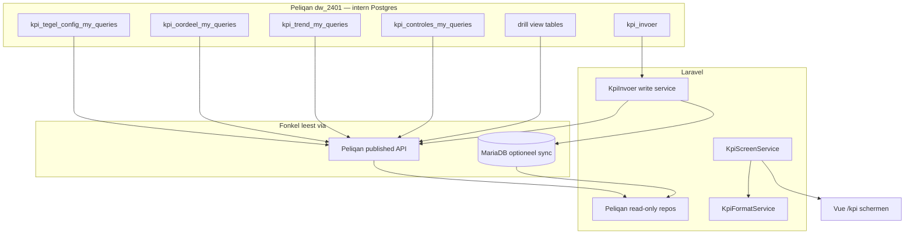

# Rebuild MT KPI-dashboard — plan in fases

**Doel:** Het dashboard laten functioneren en eruitzien zoals het [Claude-artifact / overdrachtontwerp](Overdracht%20KPI-dashboard%20Fonkel.md) en de bijbehorende schermmockups. Schermen via **`/kpi/{scherm}`**, horizontale tabnavigatie (mockup), schermopbouw **volledig uit Peliqan-config** (`kpi_tegel_config`, `kpi_oordeel`, `kpi_trend`, `kpi_controles`).

**Leidend document:** [Overdracht KPI-dashboard Fonkel.md](Overdracht%20KPI-dashboard%20Fonkel.md) (spelregels, tegelstaten, opmaak, acceptatietest).

**Referentie visueel:** kopbalk + tabnavigatie, KPI-tegel, drill-downpaneel, handmatige-invoermodal — PNG’s in [kpi-dashboard-mockups/](kpi-dashboard-mockups/) (artifact-screenshots).

---

## Vastgelegde besluiten (ADR)

| Onderwerp | Besluit |
| --- | --- |
| **Routes** | Canoniek: `/kpi/strategisch`, `/kpi/operationeel`, `/kpi/tactisch`, `/kpi/awc`, `/kpi/afc`, `/kpi/acc`. `/kpi` → strategisch. `/kpi/concern` → redirect strategisch (CONCERN-tab in UI = zelfde scherm). |
| **Legacy URLs** | `/mt-dashboard`, `/awc-dashboard`, `/afc-dashboard`, `/acc-dashboard` redirecten naar KPI-routes. Oude MT/AWC/7T-UI, controllers, composables en Peliqan-handlers zijn **verwijderd** (alleen nog in git-historie). |
| **Shell / embed** | KPI-schermen gebruiken **`KpiStandaloneLayout`** (geen Fonkel-sidebar, geen Management-topbalk) zodat het dashboard in een ander platform geïntegreerd kan worden. Mockup-kopbalk + horizontale tabs blijven onderdeel van de KPI-pagina. |
| **Leidend ontwerp** | Mockups + Overdracht; geen afwijking zonder afstemming met Chloë. |
| **Fonkel database** | **MySQL / MariaDB** (`DB_CONNECTION=mysql` in Laravel) voor app-data: users, platform, cache, eventueel lokale KPI-cache. **Geen Postgres in onze stack.** |
| **KPI-data lezen** | Bron blijft Peliqan (Overdracht); Fonkel leest **niet** rechtstreeks uit Peliqans Postgres-warehouse. Zelfde patroon als nu: **Peliqan published API** (`PELIQAN_*_URL` + JWT), uitgebreid met endpoints/views voor `kpi_*_my_queries`. Alternatief (alleen met Chloë): uurlijkse sync van die tabellen naar **MariaDB** (`DB`-connection of aparte `KPI`-connection), dan leest Laravel lokaal. |
| **KPI schrijven** | `kpi_invoer` (doelen, handmatig) via Peliqan/API of naar gesyncede MariaDB-tabellen — **niet** aannemen dat Laravel een Postgres-driver gebruikt. |

### Fonkel vs Overdracht (Postgres)

In [Overdracht KPI-dashboard Fonkel.md](Overdracht%20KPI-dashboard%20Fonkel.md) staat **Postgres** (`dw_2401`): dat is de **Peliqan datawarehouse-kant**. Voor Fonkel geldt:

- **Contract** (kolommen, spelregels, tabellen `_my_queries`) = leidend.
- **Transport** = Peliqan API en/of MySQL/MariaDB-replica — geen verplichting om Postgres in Laragon te draaien.
- Laravel `config/database.php` blijft **mysql/mariadb**; `pgsql` niet configureren tenzij je bewust een aparte sync-database toevoegt (niet de standaard).

---

## Huidige situatie (kort)

| Onderdeel | Nu | Straks |
| --- | --- | --- |
| Layout | `KpiStandaloneLayout` — KPI zonder Management-chrome | KPI-content volgens mockup; parent platform levert eigen navigatie |
| Routes | Legacy redirects + **`/kpi/*`** | Zelfde; data via Peliqan-contract |
| Data | `PeliqanClient::fetchKpi` → `KpiScreenService` (alleen KPI-contract) | Contract `kpi_*` via API of MariaDB-replica; geen KPI-rekenwerk in frontend |
| UI | Config-tegels op `/kpi/*`; legacy UI verwijderd | Config-tegels op `/kpi/*` |

**Andere pagina’s:** de demo-shell (`/dashboard`, `/operationeel/*`, `ManagementLayout`, `SidebarNav`) is verwijderd; `/dashboard` redirect naar `/kpi/strategisch` (Breeze-home na login). Alleen auth- en profielpagina’s (Breeze `AuthenticatedLayout`) blijven naast `/kpi/*`.

---

## Ontwerpprincipes (niet onderhandelbaar)

1. Frontend **toont**; Peliqan **rekent** (zie Overdracht § Spelregels).
2. Scherm = rijen uit `kpi_tegel_config` op `scherm`, gesorteerd op `positie`.
3. Getal alleen bij `weergave === meetwaarde` (of vaste tegels zonder getal).
4. Titels, volgorde, bronlabels uit config/registry — **geen hardcoded KPI-lijsten**.
5. Geen `pglh` anywhere.
6. Acceptatie = hoofdstuk Acceptatietest in Overdracht.

---

## Doelarchitectuur

**Frontend-composables (richting):**

- `useKpiScreen(scherm)` — payload: header, elementen (tegel | banner | sectie | header), trends, oordelen.
- `useKpiFormat` — nl-NL, eenheid, pijl/kleur uit `richting`.
- `useKpiDrillDown` — lazy load views uit `drill_views` in volgorde.

---

## Bouwstenen (uit mockups)

| Bouwsteen | Functie | Data |
| --- | --- | --- |
| **Kopbalk** | Logo, “MT-dashboard”, bijgewerkt, datacontroles | `kpi_controles`, tegels op scherm |
| **Tabnavigatie** | CONCERN + Strategisch → `/kpi/strategisch`; Operationeel; Tactisch; TEAMS → AWC / AFC / ACC | `KpiScreenNav.vue` |
| **Pagina-header** | Oranje label, titel, bronnen, banners | config |
| **KPI-tegel** | Alle staten Overdracht | oordel + trend |
| **Drill-downpaneel** | Views uit `drill_views` | Peliqan |
| **Handmatige invoer-modal** | `kpi_invoer.handmatig` | Tactisch |

---

## Fase 0 — Voorbereiding

- [x] Schermcodes = Overdracht: `strategisch`, `operationeel`, `tactisch`, `awc`, `afc`, `acc`
- [x] Routes `/kpi/{scherm}` + redirects legacy
- [x] KPI los van Management-chrome; host-platform levert navigatie (link naar `/kpi/strategisch` kan in het andere platform)
- [x] KPI-transport: **Peliqan API-handler** (`peliqan_kpi_api_handler.py`) voor `kpi_*` — live
- [ ] (Peliqan-side) read/write op `kpi_invoer` volgens Overdracht — geen Fonkel Postgres-user

---

## Fase 1 — Data-contract (backend)

**Doel:** Alle schermen kunnen gevuld worden zonder Vue-rekenwerk.

- [x] Peliqan handler `documentation/peliqan_kpi_api_handler.py` + deploy-doc `PELIQAN_KPI_DEPLOY.md`
- [x] Laravel: `PeliqanClient::fetchKpi`, `KpiPeliqanDataController`, `GET /kpi/peliqan/data`, `useKpiScreenLoader`
- [x] **Peliqan deploy:** `PELIQAN_KPI_DATA_URL` in `.env` + handler live in Peliqan (v6, 6 nov 2026; alle 6 schermen live)
- [ ] **Data access (MySQL/MariaDB stack):**
  - **Optie A (voorkeur):** Peliqan API endpoint(s) — `PELIQAN_KPI_DATA_URL` — JSON uit `kpi_*_my_queries`; cache TTL ≤ 1 uur (`PELIQAN_KPI_CACHE_TTL`).
  - **Optie B:** Eloquent/Query op MariaDB-tabellen (zelfde kolomnamen als Overdracht) na sync uit Peliqan.
- [x] `KpiScreenService` + `KpiFormatService` (transport-onafhankelijk)
- [x] `GET /kpi/api/screens/{scherm}` (+ `/kpi/api/drill`, `/kpi/api/controles`)
- [ ] App-tabellen voor doelen/invoer **alleen** als Chloë lokaal sync wil; anders POST via Peliqan naar `kpi_invoer`
- [x] Cache max 1 uur (`PELIQAN_KPI_CACHE_TTL`, default 3600)
- [x] Local **fixtures** (`KpiScreenFixtureProvider`, `KPI_FALLBACK_FIXTURE` in local)

**Acceptatie fase 1:** JSON `strategisch` = config + Acceptatietest-format.

---

## Fase 2 — Shell & navigatie (mockup in content)

**Doel:** Look & feel mockups; **geen Fonkel-sidebar/topbar op KPI** (embed).

- [x] Scaffold: `KpiScreenHeader`, `KpiScreenNav`, `Pages/Kpi/Screen.vue` binnen `KpiStandaloneLayout` (embed; geen Management-sidebar/topbar)
- [x] Kopbalk: echte `bijgewerkt` + datacontroles uit Peliqan
- [x] PERIODE-filter (grafieken; zie Fase 4)

**Acceptatie fase 2:** Alle 7 schermen via KPI-tabs; KPI-header (bijgewerkt + datacontroles) live.

---

## Fase 3 — Generieke UI-bouwstenen

- [x] `KpiTile.vue`, `KpiTrendSparkline.vue`, `KpiDrillDownDrawer.vue`, `KpiSectionBlock.vue`
- [x] `kpiFormat.js`, `useKpiScreenModel.js`
- [x] `KpiOmzetbrugBanner.vue` (barweergave uit `kpi_omzetbrug`-rijen, geen som)
- [x] `KpiCustomerJourneyBar.vue` (operationeel, visueel mockup)
- [x] Handmatige invoer-modal + `POST /kpi/invoer/handmatig` → MariaDB `kpi_handmatige_invoer`
- [x] Doel-editor (`KpiGoalModal`, `POST /kpi/invoer/doelen`)
- [x] Header `bijgewerkt` (oudste `bron_bijgewerkt` op scherm)
- [x] Doel-chip op tegel (`op_doel` / `bijna` / `onder_doel`)
- [ ] Peliqan sync: `php artisan kpi:export-invoer` → handmatig upload naar `kpi_invoer` (productie)

---

## Fase 4 — Schermen (pariteit mockup + Overdracht)

- [x] Secties (STRATEGISCH / AANVULLEND "Omzet en mensen") — afgeleid in `useKpiScreenModel` (strategisch: banner + `omzet_brug`/`ab_players` → AANVULLEND). Live `pijler` is alleen het thema (eyebrow op de tegel); optioneel `SECTIE: thema` forceert een sectie.
- [x] Omzetbrug waterfall (segmenten uit `kpi_omzetbrug`)
- [x] AFC Sprinter-alert uit `kpi_controles`
- [x] Operationeel klantreis-balk (visueel)
- [x] PERIODE-filter (strategisch): filtert **alleen de trendlijnen** op jaar uit `kpi_trend` (mockup: "Grafieken volgen de gekozen periode. Elke tegel heeft een vast venster"). Tegelwaarden blijven het vaste venster uit `kpi_oordeel` — het contract kent geen periode-dimensie voor waarden. Keuze onthouden in `localStorage` (`kpi.periode`), standaard huidig jaar.

---

## Fase 5 — Schrijven (doelen & handmatige invoer)

- [x] MariaDB staging + modals (eNPS, A/B, EBITDA kwartaal, doelen)
- [ ] Peliqan `kpi_invoer` productie-sync

---

## Fase 6 — Migratie & opruimen

- [x] Legacy `/mt-dashboard/legacy`, `/awc-dashboard/legacy`, `/mt-dashboard/{wms,peliqan}`, `/awc-dashboard/7t` en `debug/peliqan/7t` verwijderd (controllers, `EnsureDebugMode`, `config/mt_kpi.php`)
- [x] Oude composables/pages/components verwijderd (`useMt*`, `useAwcPeliqanData`, `useWms7tMetrics`, `useKpiTileGroups`, `MtDashboard.vue`, `TeamRapportage.vue`, `Debug/Peliqan7t.vue`, `Components/Management/*Kpi*`/panels)
- [x] `PeliqanClient` alleen nog `fetchKpi`; `config/peliqan.php` alleen `kpi_data_url` + `kpi_cache_ttl`; oude MT/AWC/7T handler-scripts en docs uit `documentation/` verwijderd

---

## Fase 7 — Acceptatie & livegang

- [ ] Runbook: [ACCEPTATIE-KPI.md](ACCEPTATIE-KPI.md) (na Peliqan live)

---

## Definition of Done (hele rebuild)

- [ ] Alle 7 schermen config-gestuurd, visueel in lijn met mockups
- [ ] Canonieke URLs `/kpi/*`; embed-klaar (geen Management-chrome op KPI)
- [ ] Acceptatietest groen; Overdracht-spelregels in review

---

*Versie 1.2 — KPI standalone layout voor embed (nov 2026).*
